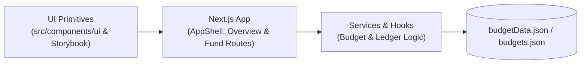

# Walden Architecture

- **`src/components/ui` & `src/theme.ts`**: Shared Chakra UI v3 primitives (`Card`, `KpiStatCard`, `DataTable`), theme, and Storybook stories (`.storybook/`).
- **`src/app/(app)` (Next.js App Router)**: Unified `AppShell` layout with collapsible left navigation, global `?year=` fiscal year slicer, and routes for Building Overview (`/funds`), Fund Summary (`/funds/[budgetId]`), General Ledger (`/funds/[budgetId]/ledger`), and Income & Expenditure (`/funds/[budgetId]/statement`).
- **Services & Data**: React Query hooks and services that transform `public/budgetData.json` and `public/budgets.json` into budget metrics, variances, and ledger entries.
